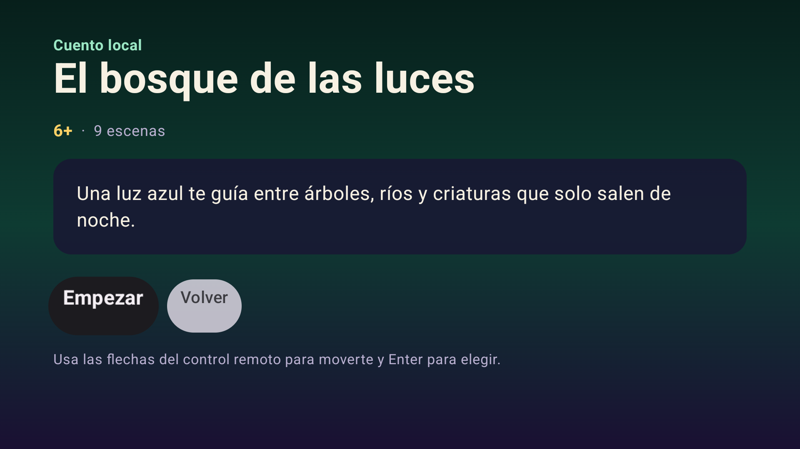
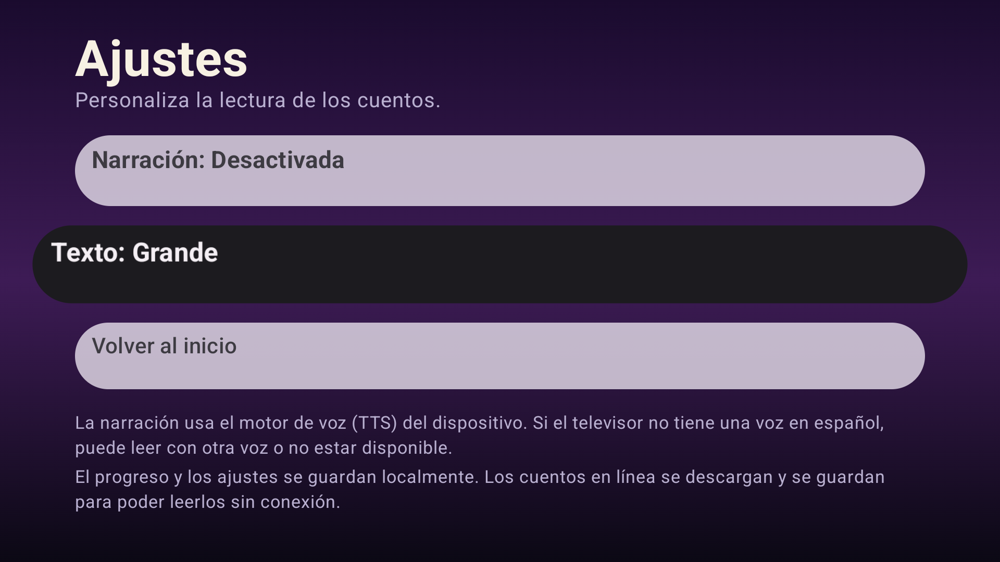

# CuentosTV

App de cuentos interactivos para **Android TV / Google TV**. El televisor muestra
una biblioteca de historias, el usuario elige con el control remoto y cada decisión
cambia el final. Incluye narración por voz (TTS), progreso guardado y un catálogo
de cuentos locales que se puede ampliar con contenido remoto.

- **Plataforma:** Android TV / Google TV (Leanback). No requiere teléfono.
- **Lenguaje:** Kotlin + Compose for TV.
- **Paquete:** `com.ejemplo.cuentostv`.
- **SDK:** compile/target 36, mínimo 30.

## Descarga

APK de prueba: [`CuentosTV-1.0-debug.apk`](https://github.com/EdwinQ12/CuentosTV/releases/download/v1.0.0/CuentosTV-1.0-debug.apk)
(release [v1.0.0](https://github.com/EdwinQ12/CuentosTV/releases/tag/v1.0.0)).

## Características

| Función | Estado |
| --- | --- |
| Biblioteca local (3 cuentos) | Incluida |
| Decisiones y múltiples finales | Incluido |
| Narración TTS en español | Incluida, con aviso si el TV no tiene voz |
| Progreso por cuento (DataStore) | Incluido |
| Continuar donde se dejó | Incluido (se limpia al llegar a un final) |
| Catálogo remoto + caché offline | Incluido (`tv-content/`) |
| Ajustes (voz y tamaño de texto) | Incluidos |
| Validación de JSON | Incluida, en tiempo de carga y en pruebas |

## Requisitos

1. Android Studio (o el SDK de Android) con:
   - Platform `android-36`
   - System image **Google TV API 36 x86_64**
2. Un AVD de TV o un televisor con depuración por USB/red.

### Emulador usado en el desarrollo

```
AVD:      CuentosTV_TV
Imagen:   system-images;android-36;google-tv;x86_64
Perfil:   tv_1080p (1920x1080)
RAM:      4096 MB
GPU:      host
```

Crear el AVD (con `avdmanager` en el PATH del SDK):

```powershell
avdmanager create avd -n CuentosTV_TV `
  -k "system-images;android-36;google-tv;x86_64" -d tv_1080p
```

Iniciar el emulador:

```powershell
emulator -avd CuentosTV_TV -port 5558 -no-snapshot -gpu host
```

## Capturas

| Inicio | Detalle |
| --- | --- |
|  |  |

| Lector | Final |
| --- | --- |
|  |  |

| Ajustes |
| --- |
|  |

## Compilar e instalar

```powershell
# desde la raíz del proyecto
$env:JAVA_HOME = "C:\Program Files\Android\Android Studio\jbr"
.\gradlew.bat :app:assembleDebug

adb -s emulator-5558 install -r app\build\outputs\apk\debug\app-debug.apk
adb -s emulator-5558 shell am start -n com.ejemplo.cuentostv/.MainActivity
```

El APK queda en `app/build/outputs/apk/debug/app-debug.apk` y se copia a
`dist/CuentosTV-1.0-debug.apk`.

## Controles

| Tecla del control | Acción |
| --- | --- |
| Flechas | Mover el foco |
| Enter / OK | Seleccionar |
| Atrás | Volver a la pantalla anterior |

La pantalla de inicio muestra **Continuar leyendo** si hay un cuento empezado.
Al llegar a un final el progreso se borra para no reanudar en el desenlace.

## Estructura del proyecto

```
app/src/main/
  java/com/ejemplo/cuentostv/
    data/        Modelos JSON, repositorio local/remoto, validador, DataStore
    ui/          ViewModel, shell de la app, narrador TTS, tema
    ui/screens/  Home, Detail, Reader, Settings
  assets/stories/  catalog.json + bosque.json, luna.json, mar.json
  res/           Banner de TV, icono, tema
app/src/test/    Pruebas del validador con JUnit
tv-content/      Catálogo remoto de ejemplo (se publica en GitHub)
docs/            Esquema de los cuentos
```

### Flujo de datos

`StoryRepository` carga primero los cuentos de `assets/stories` y después los
cuentos remotos guardados en `filesDir/remote`. Al pulsar **Actualizar cuentos**:

1. Descarga `tv-content/catalog.json`.
2. Descarga cada cuento del catálogo.
3. Valida cada cuento (escena inicial, enlaces, finales, escenas alcanzables).
4. Guarda solo los válidos y los muestra en la biblioteca aunque no haya red.

Los cuentos locales siempre están disponibles y no se pueden sobrescribir desde
la red (los IDs locales tienen prioridad).

## Contenido remoto

El catálogo remoto vive en `tv-content/` y se sirve desde GitHub:

```
https://raw.githubusercontent.com/EdwinQ12/CuentosTV/main/tv-content/catalog.json
https://raw.githubusercontent.com/EdwinQ12/CuentosTV/main/tv-content/stories/reloj.json
```

La URL base está en:

```
app/src/main/java/com/ejemplo/cuentostv/data/RemoteConfig.kt
```

Si cambia el propietario o el nombre del repositorio, solo hay que actualizar
`CONTENT_BASE` y volver a compilar. El catálogo remoto de ejemplo incluye el
cuento **El reloj del abuelo**.

### Probar sin publicar en GitHub

La variante `debug` permite HTTP en claro para usar un servidor local:

```powershell
# en la raíz del proyecto
python -m http.server 8000 --bind 127.0.0.1
```

Cambia `CONTENT_BASE` a `http://10.0.2.2:8000/tv-content` (la IP del host desde
el emulador), compila, entra a la app y pulsa **Actualizar cuentos**. Después
vuelve a la URL de GitHub antes de generar el APK final.

### Formato

Ver [`docs/esquema-cuentos.md`](docs/esquema-cuentos.md). Resumen:

```json
{
  "schemaVersion": 1,
  "id": "reloj",
  "title": "El reloj del abuelo",
  "start": "inicio",
  "nodes": {
    "inicio": {
      "text": "Texto de la escena.",
      "theme": "CASTLE",
      "choices": [
        { "text": "Opción uno", "next": "final" }
      ]
    },
    "final": {
      "text": "Texto del final.",
      "theme": "CASTLE",
      "ending": true,
      "endingTitle": "Título del final"
    }
  }
}
```

## Pruebas

```powershell
.\gradlew.bat :app:testDebugUnitTest
.\gradlew.bat :app:lintDebug
```

Las pruebas cubren: cuento válido, escena inicial inexistente, escena sin
decisiones, enlaces rotos, ausencia de finales, escenas inalcanzables, cuento
vacío y los cuentos locales/remotos incluidos.

Resultado actual: **9 pruebas, 0 fallos**.

## Limitaciones conocidas

- La narración depende del motor TTS del televisor. Si no hay voz en español,
  la app avisa y el texto sigue disponible.
- Los cuentos son texto y color; no hay ilustraciones ni audio grabado.
- El catálogo remoto usa `raw.githubusercontent.com`, pensado para un proyecto
  académico. Para producción conviene un CDN o una API propia.
- El APK de `dist/` es de **debug** (firmado con la clave de depuración). Para
  publicar en Google Play hay que generar un keystore y firmar en release.
- La app está pensada para pantallas de TV en horizontal; no incluye versión
  para teléfono.

## Créditos

Proyecto académico. Cuentos originales escritos para la app.
