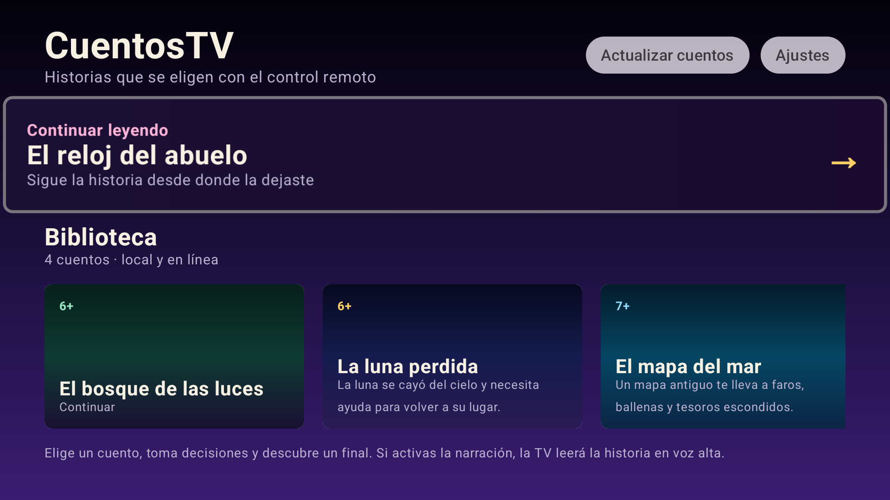
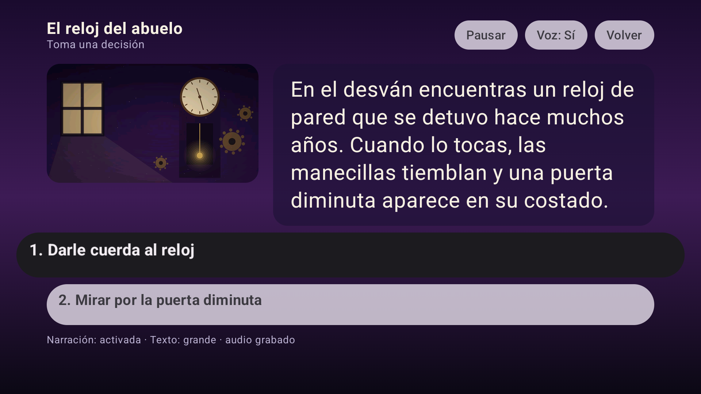
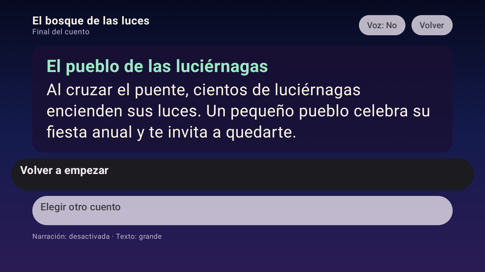
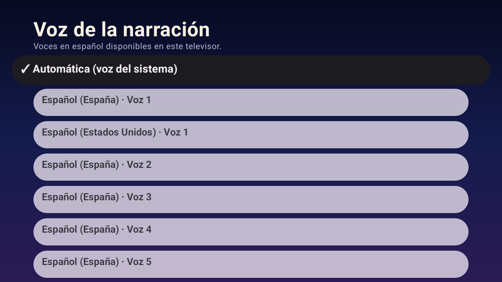

# CuentosTV

App de cuentos interactivos para **Android TV / Google TV**. El televisor muestra
una biblioteca de historias ilustradas, el usuario elige con el control remoto y
cada decisión cambia el final. Incluye narración por voz (TTS) con selección de
voz y velocidad, progreso guardado y un catálogo local que se puede ampliar con
contenido remoto.

- **Plataforma:** Android TV / Google TV (Leanback). No requiere teléfono.
- **Lenguaje:** Kotlin + Compose for TV.
- **Paquete:** `com.ejemplo.cuentostv`.
- **SDK:** compile/target 36, mínimo 30.

## Descarga

APK de prueba: [`CuentosTV-1.2.0-debug.apk`](https://github.com/EdwinQ12/CuentosTV/releases/download/v1.2.0/CuentosTV-1.2.0-debug.apk)
(release [v1.2.0](https://github.com/EdwinQ12/CuentosTV/releases/tag/v1.2.0)).

## Características

| Función | Estado |
| --- | --- |
| Biblioteca local (3 cuentos ilustrados) | Incluida |
| Decisiones y múltiples finales | 17–19 escenas y 9–10 finales por cuento |
| Narración con audio grabado | En los 3 cuentos locales y en el remoto |
| Respaldo automático a TTS | Incluido si una escena no tiene audio |
| Pausar / seguir / repetir narración | Incluido |
| Selección de voz del televisor | Incluida (voces locales y en línea) |
| Velocidad de lectura | Lenta / Normal / Rápida |
| Progreso por cuento (DataStore) | Incluido |
| Continuar donde se dejó | Incluido (se limpia al llegar a un final) |
| Catálogo remoto + caché offline | Incluido (`tv-content/`) |
| Portadas e ilustraciones por escena | Incluidas, con caché para las remotas |
| Ajustes de voz y tamaño de texto | Incluidos |
| Validación de JSON | En carga y en pruebas |

## Capturas

| Inicio | Detalle |
| --- | --- |
|  |  |

| Lector | Final |
| --- | --- |
|  |  |

| Ajustes | Voces |
| --- | --- |
|  |  |

## Requisitos

1. Android Studio (o el SDK de Android) con:
   - Platform `android-36`
   - System image **Google TV API 36 x86_64**
2. Un AVD de TV o un televisor con depuración por USB/red.

### Emulador usado en el desarrollo

```
AVD:      CuentosTV_TV
Imagen:   system-images;android-36;google-tv;x86_64
Perfil:   tv_1080p (1920x1080)
RAM:      4096 MB
GPU:      host
```

Crear el AVD:

```powershell
avdmanager create avd -n CuentosTV_TV `
  -k "system-images;android-36;google-tv;x86_64" -d tv_1080p
```

Iniciar el emulador (sin `-no-audio` para escuchar la narración):

```powershell
emulator -avd CuentosTV_TV -port 5558 -no-snapshot -gpu host
```

## Compilar e instalar

```powershell
# desde la raíz del proyecto
$env:JAVA_HOME = "C:\Program Files\Android\Android Studio\jbr"
.\gradlew.bat :app:assembleDebug

adb -s emulator-5558 install -r app\build\outputs\apk\debug\app-debug.apk
adb -s emulator-5558 shell am start -n com.ejemplo.cuentostv/.MainActivity
```

El APK queda en `app/build/outputs/apk/debug/app-debug.apk` y se copia a
`dist/CuentosTV-1.1.0-debug.apk`.

## Controles

| Tecla del control | Acción |
| --- | --- |
| Flechas | Mover el foco |
| Enter / OK | Seleccionar |
| Atrás | Volver a la pantalla anterior |

La pantalla de inicio muestra **Continuar leyendo** si hay un cuento empezado.
Al llegar a un final el progreso se borra para no reanudar en el desenlace.

## Narración: audio grabado y TTS

Cada escena puede traer su propia narración en `audio`. Si el archivo existe, la
app lo reproduce y **no** usa TTS; si no existe, usa la voz del televisor como
respaldo. Así se puede tener una voz humana o neuronal solo en algunas escenas y
el resto sigue funcionando.

- **Audio local:** `app/src/main/assets/stories/audio/`
- **Audio remoto:** `tv-content/audio/`; se descarga con **Actualizar cuentos** y
  se guarda en `filesDir/remote/audio`.
- En el lector aparecen **Pausar / Seguir / Repetir** cuando la escena tiene audio.
- Los MP3 incluidos se generaron en español latino (Microsoft Sabina, es-MX) con:

```powershell
powershell -ExecutionPolicy Bypass -File tools\generar-audio.ps1 `
  -Story app\src\main\assets\stories\bosque.json `
  -Out app\src\main\assets\stories\audio
```

Para usar una voz más natural, reemplaza esos MP3 por grabaciones humanas o por
audio de una voz neuronal, manteniendo el nombre `<cuento>_<escena>.mp3`.

## Narración y voz (TTS)

En **Ajustes** puedes:

- Activar o desactivar la narración.
- Elegir **Voz** entre las voces en español que ofrece el motor TTS del
  televisor. Las voces marcadas como *En línea* necesitan internet.
- Cambiar la **Velocidad**: Lenta, Normal o Rápida.
- **Probar narración** sin salir de la pantalla.

La voz elegida se guarda y se aplica al leer los cuentos. Si el televisor no
tiene una voz en español, la app lo avisa y el texto sigue disponible. El botón
**Abrir ajustes de voz del televisor** lleva a la configuración del sistema para
instalar más voces o motores TTS.

## Imágenes

Cada cuento puede tener una portada (`cover`) y cada escena una ilustración
(`image`). Las imágenes locales viven en:

```
app/src/main/assets/stories/images/
```

Las remotas se descargan desde `tv-content/images/` y se guardan en
`filesDir/remote/images`, así que también se ven sin conexión. Si una imagen no
está disponible, la app usa el degradado del tema como respaldo.

Las ilustraciones incluidas se generan con un script reproducible:

```powershell
powershell -ExecutionPolicy Bypass -File tools\generar-ilustraciones.ps1
```

## Estructura del proyecto

```
app/src/main/
  java/com/ejemplo/cuentostv/
    data/        Modelos JSON, repositorio local/remoto, validador, DataStore
    ui/          ViewModel, shell, narrador TTS, reproductor de audio, tema
    ui/components/  Carga de imágenes de los cuentos
    ui/screens/  Home, Detail, Reader, Settings, Voices
  assets/stories/  catalog.json, cuentos, imágenes y audio
  res/           Banner de TV, icono, tema
app/src/test/    Pruebas del validador, imágenes y audios
tv-content/      Catálogo remoto publicado (cuentos, imágenes y audio)
tools/           Generadores de ilustraciones y de narración
docs/            Esquema de los cuentos y guía para agregar contenido
```

### Flujo de datos

`StoryRepository` carga primero los cuentos de `assets/stories` y después los
cuentos remotos guardados en `filesDir/remote`. Al pulsar **Actualizar cuentos**:

1. Descarga `tv-content/catalog.json`.
2. Descarga cada cuento del catálogo.
3. Valida cada cuento (escena inicial, enlaces, finales, escenas alcanzables).
4. Descarga las imágenes y los audios del cuento que falten.
5. Guarda solo los cuentos válidos y los muestra aunque no haya red.

Los cuentos locales siempre están disponibles y tienen prioridad sobre uno
remoto con el mismo ID.

## Contenido remoto

El catálogo remoto vive en `tv-content/` y se sirve desde GitHub:

```
https://raw.githubusercontent.com/EdwinQ12/CuentosTV/main/tv-content/catalog.json
https://raw.githubusercontent.com/EdwinQ12/CuentosTV/main/tv-content/stories/reloj.json
https://raw.githubusercontent.com/EdwinQ12/CuentosTV/main/tv-content/images/reloj.jpg
https://raw.githubusercontent.com/EdwinQ12/CuentosTV/main/tv-content/audio/reloj_inicio.mp3
```

La URL base está en
`app/src/main/java/com/ejemplo/cuentostv/data/RemoteConfig.kt`. Si cambia el
propietario o el nombre del repositorio, actualiza `CONTENT_BASE` y recompila.

### Cómo agregar más cuentos

Hay dos caminos, explicados paso a paso en
[`docs/agregar-cuentos.md`](docs/agregar-cuentos.md):

- **Local:** agregar el JSON y las imágenes en `assets`, y recompilar.
- **Remoto:** agregar el JSON y las imágenes en `tv-content/`, subirlo a GitHub
  y pulsar **Actualizar cuentos** en la TV. No hay que recompilar ni actualizar
  la app.

El formato está documentado en [`docs/esquema-cuentos.md`](docs/esquema-cuentos.md).
Resumen:

```json
{
  "schemaVersion": 1,
  "id": "reloj",
  "title": "El reloj del abuelo",
  "start": "inicio",
  "nodes": {
    "inicio": {
      "text": "Texto de la escena.",
      "theme": "CASTLE",
      "image": "reloj.jpg",
      "audio": "reloj_inicio.mp3",
      "choices": [
        { "text": "Opción uno", "next": "final" }
      ]
    },
    "final": {
      "text": "Texto del final.",
      "theme": "CASTLE",
      "image": "reloj.jpg",
      "audio": "reloj_final.mp3",
      "ending": true,
      "endingTitle": "Título del final"
    }
  }
}
```

## Pruebas

```powershell
.\gradlew.bat :app:testDebugUnitTest
.\gradlew.bat :app:lintDebug
```

Las pruebas cubren: cuento válido, escena inicial inexistente, escena sin
decisiones, enlaces rotos, ausencia de finales, escenas inalcanzables, cuento
vacío, cuentos incluidos y existencia de todas las imágenes y audios
referenciados.

Resultado actual: **11 pruebas, 0 fallos**.

## Limitaciones conocidas

- El audio incluido se generó con la voz latina de Windows (Microsoft Sabina,
  es-MX). Es más cálido que el TTS del televisor, pero se puede reemplazar por
  grabaciones humanas o voz neuronal sin cambiar código.
- Sin audio grabado, la narración depende del motor TTS del televisor. Las voces
  en línea requieren internet y pueden tardar en aparecer.
- Las ilustraciones son gráficos vectoriales generados por script; no son fotos
  ni dibujos hechos a mano.
- El catálogo remoto usa `raw.githubusercontent.com`, pensado para un proyecto
  académico. Para producción conviene un CDN o una API propia.
- El APK de `dist/` es de **debug** (firmado con la clave de depuración). Para
  publicar en Google Play hay que generar un keystore y firmar en release.
- La app está pensada para pantallas de TV en horizontal; no incluye versión
  para teléfono.

## Créditos

Proyecto académico. Cuentos originales escritos para la app e ilustraciones
generadas con `tools/generar-ilustraciones.ps1`.
